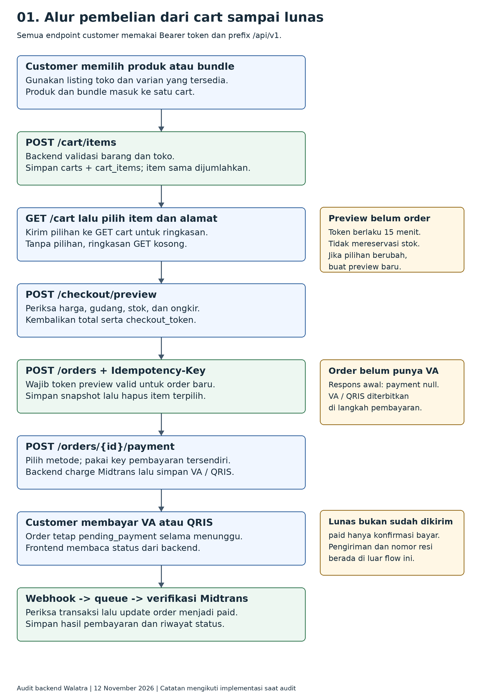
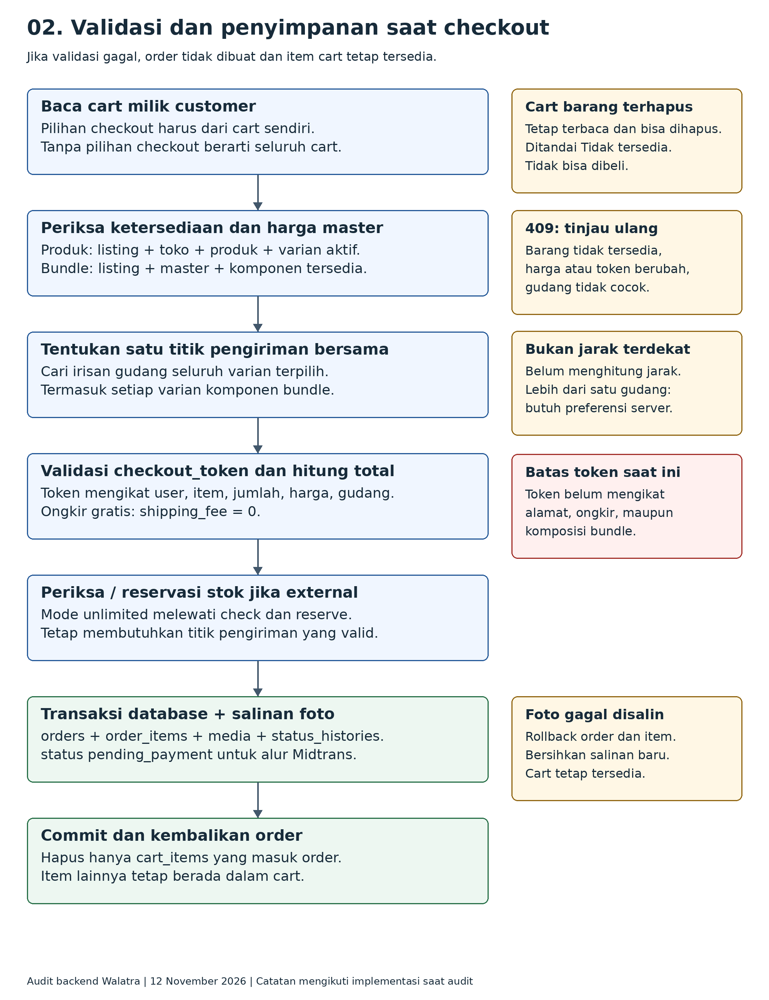
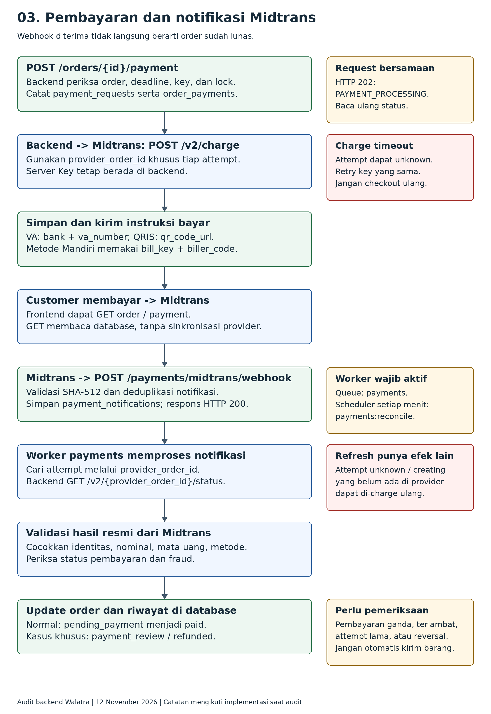

# Audit Flow API Cart, Checkout, dan Pembayaran

Tanggal audit: **12 November 2026**. Berdasarkan kode, konfigurasi aplikasi yang dimuat, dan pengujian API terisolasi pada repository backend ini.

Alur utama: **pilih barang → cart → preview → buat order → buat pembayaran → bayar VA/QRIS → webhook dan verifikasi Midtrans → order lunas**.

> **Kesimpulan:** alur normal memiliki pengujian yang lulus. Pembacaan cart setelah listing dihapus sudah diperbaiki: item tetap tampil sebagai tidak tersedia dan dapat dihapus. Ringkasan pilihan tersedia dan token preview wajib untuk order baru. Efek charge pada proses refresh tertentu dan filter toko tetap menjadi catatan terpisah. Detailnya ada pada bagian 9. Pembayaran yang dikonfigurasi saat audit masih **sandbox**, sehingga hasil ini bukan bukti pembayaran production.

## 1. Cara membaca diagram

Kotak biru menunjukkan proses, hijau menunjukkan penyimpanan atau perubahan data, kuning berisi catatan, dan merah berisi batasan yang perlu diperhatikan. Panah menunjukkan urutan atau perpindahan data. Diagram utama mengikuti mode `integrated` dengan Midtrans yang sedang dikonfigurasi.

Diagram menggunakan gambar PNG lokal agar tampil tanpa plugin Mermaid. File SVG tersedia untuk memperbesar atau mencetak tanpa kehilangan ketajaman. Saat mengekspor Markdown ke PDF, gunakan exporter yang memuat gambar lokal dan pertahankan folder `assets/order-flow` di lokasi relatif yang sama.



[Buka diagram 1 dalam SVG](assets/order-flow/01-overview.svg).

## 2. Kondisi aplikasi saat audit

| Pengaturan | Nilai yang dimuat | Dampak pada flow |
|---|---|---|
| Mode order | `integrated` | Order baru menggunakan Midtrans Core API. |
| Simulasi otomatis lunas | Nonaktif | Checkout tidak langsung menganggap order dibayar. |
| Lingkungan Midtrans | `sandbox` | VA/QRIS merupakan transaksi pengujian. |
| Server Key | Sudah terkonfigurasi | Nilai key tidak dicantumkan dalam dokumentasi. |
| Mode stok | `unlimited` | Check, reserve, dan pengurangan stok eksternal dilewati. |
| Gratis ongkir | Aktif | `shipping_fee = 0`; tidak meminta tarif ongkir eksternal. |
| Preferensi kode gudang | Belum diisi | Otomatis hanya jika seluruh item memiliki tepat satu gudang bersama. |
| API direktori gudang | Aktif | Preview dan pembuatan order tetap membutuhkan daftar dan detail gudang. |
| Queue | `redis` | Job pembayaran memakai antrean bernama `payments`. |
| Deadline order | 24 jam | Ditetapkan ketika order Midtrans dibuat. |
| Masa berlaku VA | Maksimal 1.440 menit | Dibatasi juga oleh deadline order. |
| Masa berlaku QRIS | Maksimal 15 menit | Dibatasi juga oleh deadline order. |

> **Wajib diketahui:** unlimited hanya berlaku untuk stok. Pengaturan gudang tidak dilewati. Sistem juga belum menghitung gudang terdekat dari koordinat pembeli. Tasikmalaya akan terpilih jika menjadi satu-satunya gudang bersama atau ditetapkan sebagai preferensi yang valid untuk semua barang terpilih.

Nilai di atas adalah kondisi saat audit, bukan nilai yang otomatis berlaku di server lain. Pengaturan default kode untuk mode order adalah `manual`; server baru harus dikonfigurasi jika akan memakai Midtrans.

**Cabang manual:** checkout menghasilkan order `pending_payment` dengan provider `manual`. Endpoint pembayaran mengembalikan instruksi verifikasi admin, tanpa menerbitkan VA/QRIS; admin mengonfirmasi lunas melalui panel Pesanan. Cabang ini tidak menunggu webhook Midtrans.

**Cabang simulasi:** hanya dapat aktif pada environment `local`/`testing` ketika flag simulasi diaktifkan dan mode manual tidak aktif. Order langsung berstatus `paid` dengan provider `simulation`. Cabang ini nonaktif saat audit. Provider, mode stok, dan nominal ongkir ditentukan backend, bukan pilihan bebas dari body request customer.

## 3. Endpoint dan data yang dibutuhkan

Base path seluruh endpoint berikut: **`/api/v1`**.

Endpoint customer membutuhkan `Authorization: Bearer <token>`, token dengan ability `customer-api`, serta akun aktif. Kirim `Accept: application/json`; body JSON memakai `Content-Type: application/json`.

| Tahap | Method dan endpoint | Masukan / hasil utama |
|---|---|---|
| Tambah produk | `POST /cart/items` | `type: product`, `listing_id`, `variant_id`, `quantity`. |
| Tambah bundle | `POST /cart/items` | `type: bundle`, `bundle_listing_id`, `quantity`. |
| Lihat cart | `GET /cart` | Satu daftar gabungan produk dan bundle. |
| Ubah jumlah | `PATCH /cart/items/{item}` | `quantity` antara 1 dan 99. |
| Hapus item | `DELETE /cart/items/{item}` | Menghapus item dalam cart customer. |
| Kosongkan cart | `DELETE /cart` | Menghapus seluruh item cart customer. |
| Daftar alamat | `GET /addresses` | Ambil ID alamat untuk checkout. |
| Preview | `POST /checkout/preview` | Pilihan item, alamat, total terbaru, token checkout. |
| Buat order | `POST /orders` | Header `Idempotency-Key`; hasil order dan snapshot. |
| Metode pembayaran | `GET /payment-methods` | Metode yang diaktifkan server dan masa berlakunya. |
| Buat pembayaran | `POST /orders/{order}/payment` | `method` dan header `Idempotency-Key`. |
| Baca pembayaran | `GET /orders/{order}/payment` | Data pembayaran tersimpan; tidak memanggil status Midtrans. |
| Sinkronisasi pembayaran | `POST /orders/{order}/payment/refresh` | Periksa status ke Midtrans; lihat catatan efek samping di bagian 9. |
| Ambil gambar QR | `GET /orders/{order}/payments/{payment}/qr-code` | PNG; tetap membutuhkan Bearer token. |
| Detail order | `GET /orders/{order}` | Status order, payment aktif, item, alamat, dan total. |
| Daftar order | `GET /orders` | Order customer sendiri, pagination 15 per halaman. |
| Batalkan order | `POST /orders/{order}/cancel` | Pembatalan order yang masih dapat dibatalkan. |
| Notifikasi provider | `POST /payments/midtrans/webhook` | Tanpa Bearer token; wajib signature Midtrans valid. |

`{order}` adalah **ID database order**, bukan `order_number`. `listing_id` adalah ID etalase toko, bukan ID produk master. `cart_item_ids` berisi ID baris cart, bukan `variant_id`.

### Tambah cart

```json
{
  "type": "product",
  "listing_id": 101,
  "variant_id": 201,
  "quantity": 2
}
```

ID dalam contoh bersifat ilustratif dan harus diambil dari katalog aktif. Produk yang sama pada listing dan varian yang sama dijumlahkan, bukan dibuat menjadi baris baru. Penambahan berulang dibatasi ke total 99. Bundle yang sama juga dijumlahkan.

Cart diurutkan berdasarkan waktu terakhir **ditambahkan**, terbaru di atas. Mengubah quantity melalui PATCH tidak memindahkan urutan. Cart menyimpan harga ketika ditambahkan; harga ini belum merupakan konfirmasi harga checkout.

> **Catatan toko:** satu cart bisa berisi beberapa toko. Respons menyediakan `items[].store`, tetapi `GET /cart?store_id=...` belum memfilter hasil. Pengelompokan per toko saat ini dapat memakai data tersebut di frontend.

## 4. Preview dan pembuatan order



[Buka diagram 2 dalam SVG](assets/order-flow/02-checkout.svg).

### Langkah A: pilih item dan alamat

```json
{
  "cart_item_ids": [301, 302],
  "address_id": 401
}
```

Kirim body ini ke `POST /checkout/preview`. Produk dan bundle dapat dipilih dalam request yang sama. Tanpa `cart_item_ids`, backend memakai seluruh isi cart. Array kosong, ID duplikat, ID asing, atau item yang sudah tidak ada ditolak.

Alamat dapat memakai `address_id` milik customer atau objek `shipping_address`. Jika keduanya dikirim, kode menggunakan `address_id`. Preview boleh tanpa alamat, tetapi `shipping` dan `total` akan `null`; pembuatan order memerlukan alamat.

### Langkah B: backend meninjau ulang

Backend memeriksa listing, kelayakan toko, produk, varian, serta komponen bundle. Harga diambil ulang dari master varian atau harga tetap master bundle. Perubahan harga muncul pada `price_changed` dan `price_changes`; preview tidak menyimpan harga baru ke baris cart.

Untuk gudang, backend mencari **irisan penugasan gudang seluruh varian terpilih**, termasuk komponen bundle. Order tidak dipecah menjadi beberapa gudang. Gudang bersama yang dipilih lalu diambil detailnya dari API direktori gudang.

Preview mengembalikan `checkout_available`, `stock_mode`, `stock_verification`, `shipping_origin`, `checkout_token`, `items`, `subtotal`, `shipping`, dan `total`. `checkout_available: true` pada mode unlimited tidak membuktikan stok fisik tersedia. Nilai `stock_verification: pending_manual` berarti stok belum diverifikasi otomatis.

### Langkah C: konfirmasi dan buat order

Kirim pilihan dan alamat ke `POST /orders`, tambahkan `checkout_token` dari preview, serta header:

```http
Idempotency-Key: checkout-unik-untuk-satu-pembelian
```

```json
{
  "cart_item_ids": [301, 302],
  "address_id": 401,
  "checkout_token": "TOKEN_DARI_PREVIEW"
}
```

Header wajib terisi, maksimal 100 karakter. Backend mengunci pemilik cart dan data terkait saat membuat order, memvalidasi ulang harga dan gudang, lalu menyimpan order, snapshot item, alamat, titik pengiriman, salinan berkas foto, serta riwayat status awal.

Respons order baru menggunakan **HTTP 201**. Pada mode integrated, status awal **`pending_payment`**, provider **`midtrans`**, integration **`core_api`**, dan **`payment: null`**. Belum ada nomor VA atau QRIS pada tahap ini.

Hanya item terpilih yang dihapus setelah order berhasil. Jika penyalinan foto gagal, transaksi database dibatalkan, salinan baru dibersihkan, dan item cart tetap ada. Tanpa foto sumber, order tetap dapat dibuat dengan `image_url: null`.

> **Idempotency order:** retry key yang sama oleh customer yang sama mengembalikan order lama, biasanya HTTP 200, tanpa membuat order atau salinan foto baru. Key yang sama tidak menandakan pembelian baru dan payload baru tidak digunakan untuk mengubah order lama. Validasi bentuk request tetap berlaku sebelum controller mengembalikan order lama.

> **Token checkout:** masa berlaku 15 menit. Token mengikat customer, pilihan item, quantity, harga, dan kode gudang. Token wajib untuk setiap order baru; tanpa token menghasilkan 422 pada field `checkout_token`. Retry key order yang telah berhasil tetap mengembalikan order lama walaupun token kedaluwarsa atau tidak disertakan. Token belum mengikat alamat, ongkir, atau detail komposisi bundle. Untuk alur pembelian, gunakan preview dan kirim tokennya; jangan menganggap token sebagai penguncian seluruh isi halaman checkout.

## 5. Pembuatan dan pembacaan pembayaran



[Buka diagram 3 dalam SVG](assets/order-flow/03-payment.svg).

Setelah menerima ID order, ambil metode dari `GET /payment-methods`. Kode mendukung `bca_va`, `bni_va`, `bri_va`, `permata_va`, `mandiri_bill`, dan `qris`; hasil endpoint mengikuti konfigurasi server.

Contoh pembuatan pembayaran:

```http
POST /api/v1/orders/501/payment
Authorization: Bearer <token>
Idempotency-Key: pembayaran-unik-untuk-pilihan-metode-ini
Content-Type: application/json
```

```json
{
  "method": "bca_va"
}
```

Gunakan key pembayaran tersendiri, terpisah secara penggunaan dari key checkout. Backend memeriksa status order dan deadline, mencatat percobaan pembayaran, membuat referensi provider seperti `WAL-...-P000001`, lalu mengirim charge dari server ke Midtrans. Satu order dapat memiliki beberapa percobaan pembayaran, tetapi totalnya tetap total seluruh order, termasuk ketika barang berasal dari beberapa toko.

Respons pembayaran baru **HTTP 201**; penggunaan ulang pembayaran biasanya **HTTP 200**. Instruksi terdapat di **`data.payment`**:

| Metode | Field instruksi |
|---|---|
| BCA/BNI/BRI/Permata VA | `bank`, `va_number`, `amount`, `expires_at`. |
| Mandiri Bill Payment | `biller_code`, `bill_key`, `amount`, `expires_at`. |
| QRIS | `qr_code_url`, `amount`, `expires_at`. |

`payment_token` dan `payment_url` bernilai `null` untuk alur ini. Aplikasi menampilkan VA atau QRIS dari JSON, tanpa halaman Snap. Instruksi pembayaran disimpan di database dan dapat dibaca ulang dari endpoint payment maupun detail order.

> **QRIS:** `qr_code_url` mengarah ke endpoint backend yang memerlukan Authorization. Elemen gambar biasa tidak selalu mengirim Bearer token. Ambil PNG dengan request berautentikasi lalu tampilkan hasilnya. QR hanya dapat diambil untuk attempt aktif, berstatus pending, belum kedaluwarsa, dan dengan lingkungan yang sesuai.

Key pembayaran yang sama mengacu pada percobaan yang sama. Menggunakan key yang sama untuk metode berbeda ditolak dengan `IDEMPOTENCY_CONFLICT`. Mengganti metode menggunakan key baru; backend terlebih dahulu menyinkronkan dan memastikan percobaan aktif lama sudah ditutup sebelum membuat percobaan baru. Attempt pending yang sama dan masih berlaku dapat dipakai kembali meski request memakai key baru.

> **Timeout charge bukan bukti pembayaran gagal:** attempt dapat tersimpan sebagai `unknown`. Pertahankan order dan key pembayaran, lalu lakukan pemulihan status. Jangan langsung membuat checkout baru, karena transaksi provider sebelumnya mungkin sudah berhasil dibuat.

## 6. Webhook, worker, dan sinkronisasi

Notification URL Midtrans harus menunjuk ke:

```text
https://DOMAIN-BACKEND/api/v1/payments/midtrans/webhook
```

Webhook tidak membutuhkan login customer. Backend memverifikasi signature SHA-512 menggunakan Server Key, menyimpan notifikasi secara persisten, dan melakukan deduplikasi. HTTP 200 `PAYMENT_WEBHOOK_ACCEPTED` berarti notifikasi diterima; proses order dapat belum selesai.

Job `ProcessMidtransNotification` berjalan pada queue `payments`. Job mencari attempt menggunakan `provider_order_id`, kemudian mengambil status resmi melalui Midtrans Get Status API. Status pada payload webhook saja tidak langsung dipakai untuk menyatakan lunas.

Sebelum mengubah status, backend memeriksa referensi transaksi, nominal, mata uang IDR, metode, transaction ID, status, dan fraud. Untuk pembayaran normal yang valid, backend menyimpan payment sebagai `paid`, mengubah order menjadi `paid`, mencatat waktu dan riwayat, serta mengonfirmasi reservasi stok jika ada. Mode unlimited tidak mempunyai reservasi stok untuk dikonfirmasi.

Contoh menjalankan worker sesuai koneksi aplikasi saat audit:

```bash
php artisan queue:work redis --queue=payments --tries=5 --timeout=60
```

Scheduler Laravel memiliki `payments:reconcile` setiap menit. Command ini mengantrekan ulang notifikasi belum diproses serta sinkronisasi order yang memenuhi kriteria. Cron/scheduler dan worker perlu berjalan terus di server. Audit ini memeriksa definisi dan tesnya; tidak membuktikan proses server tersebut aktif terus-menerus.

Frontend dapat membaca ulang `GET /orders/{order}` atau `GET /orders/{order}/payment`. Keduanya membaca data tersimpan. `POST .../payment/refresh` menghubungi provider, dibatasi 12 request/menit per customer per order. Pembuatan pembayaran dibatasi 10 request/menit pada lingkup yang sama. Tidak ada push realtime customer pada flow API ini; frontend perlu memuat ulang status.

## 7. Status, pembatalan, dan penanganan gagal

Status **order** dan status **attempt pembayaran** berbeda. Satu attempt kedaluwarsa tidak otomatis berarti order langsung kedaluwarsa.

| Kondisi | Perilaku yang perlu dipahami |
|---|---|
| Order baru | `pending_payment`, belum ada attempt. |
| VA/QRIS diterbitkan | Attempt `pending`; order masih `pending_payment`. |
| QRIS habis sebelum deadline order | Attempt dapat `expired`; dapat meminta pembayaran baru selama order masih terbuka. |
| Pembayaran normal terverifikasi | Order menjadi `paid`; ini belum berarti barang dikirim. |
| Pembayaran terlambat, attempt lama, ganda, atau status khusus | Dapat menjadi `payment_review`; perlu pemeriksaan admin. |
| Attempt `deny`, `failure`, `cancel`, atau `expire` | Tidak otomatis memetakan order ke terminal state yang sama; order dapat tetap menunggu sampai ditutup atau dibayar dengan attempt lain. |
| Pembatalan customer | Backend menyinkronkan provider dan menutup pembayaran sebelum menutup order. Jika ternyata sudah lunas, pembatalan ditolak. |
| Deadline order berakhir | Sinkronisasi/rekonsiliasi menutup pembayaran dan mengubah order menjadi `expired`; bukan hanya timer frontend. |
| Refund penuh terverifikasi | Dapat mengubah order menjadi `refunded`; API ini tidak menyediakan aksi customer untuk memulai refund. |

Pembatalan tidak otomatis memasukkan barang kembali ke cart. Item yang sudah di-checkout telah berpindah menjadi snapshot order.

| Respons | Arti / tindak lanjut |
|---|---|
| `401` / `403` | Periksa token, ability, dan status akun. |
| `404` | Data tidak ditemukan atau bukan milik customer; jangan menebak ID lain. |
| `422` | Perbaiki field request, pilihan cart, alamat, atau header yang wajib. |
| `422` pada `checkout_token` | Buat preview sebelum order baru dan kirim token asli yang valid. |
| `409 CHECKOUT_CHANGED` / `CHECKOUT_EXPIRED` | Buat preview baru untuk pilihan saat ini. |
| `409 STALE_CART` | Perbarui pilihan barang yang tidak tersedia. Preview tidak selalu menyertakan field `code` ini. |
| `409 WAREHOUSE_*` | Periksa penugasan gudang dan preferensi server. |
| `409 ORDER_NOT_PAYABLE` / `PAYMENT_DEADLINE_REACHED` | Jangan terus membuat attempt; baca ulang order. |
| `202 PAYMENT_PROCESSING` | Operasi pembayaran lain sedang berjalan. `data` dapat `null`; baca ulang status, belum tentu ada VA/QRIS. |
| `503 PAYMENT_UNAVAILABLE` | Provider belum dapat dikonfirmasi; pertahankan key dan periksa status. |
| `503 WAREHOUSE_DIRECTORY_UNAVAILABLE` | Preview/order terhalang API direktori gudang, meskipun stok unlimited. |
| `429` | Tunda request sesuai kebijakan rate limit. |

## 8. Data yang mengalir dan disimpan

| Penyimpanan | Data utama | Kapan berubah |
|---|---|---|
| `carts`, `cart_items` | Pemilik, listing toko, varian/bundle, quantity, harga cart, waktu tambah. | Tambah, ubah, hapus cart; item terpilih dihapus setelah order dibuat. |
| Master produk/varian/bundle dan listing | Status tersedia, harga aktif, komponen bundle, identitas toko. | Dibaca ulang saat preview/order. |
| Penugasan gudang varian + API direktori gudang | Gudang bersama dan detail titik pengiriman. | Dibaca pada preview/order; hasil pilihan disalin ke order. |
| `orders` | Nomor, customer, key checkout, status, total, deadline, alamat, origin, mode stok. | Checkout dan perubahan status pembayaran/order. |
| `order_items`, `media` | Snapshot nama, SKU, toko, harga, quantity, komponen bundle, salinan foto. | Saat checkout; tidak bergantung pada foto sumber untuk riwayat. |
| `order_status_histories` | Catatan perubahan status order. | Order dibuat dan transisi status. |
| `payment_requests` | Pemetaan key request pembayaran, metode, dan attempt. | Pembuatan/retry pembayaran. |
| `order_payments` | Attempt, provider order ID, lingkungan, instruksi VA/QR, nominal, status, waktu sinkronisasi. | Charge dan verifikasi status provider. |
| `payment_notifications` | Inbox webhook, identitas event, payload tervalidasi, penanda selesai diproses. | Penerimaan webhook dan pemrosesan job. |

Foto item produk mengikuti foto varian → galeri listing toko → galeri produk master. **Kondisi bundle saat audit:** foto listing bundle → galeri produk master komponen pertama. Kode saat ini belum memakai foto master bundle tersendiri sebagai cadangan gambar cart. Riwayat order memakai berkas foto yang disalin ketika checkout.

## 9. Temuan audit dan urutan tindak lanjut

Bagian ini menyimpan temuan audit awal dan status sesudah perbaikan cart/checkout. Integrasi pembayaran tidak diubah pada pekerjaan perbaikan ini.

### Selesai: cart tetap terbaca setelah listing dihapus

**Temuan awal:** tambah produk ke cart lalu soft delete listing menyebabkan GET cart 500. **Setelah perbaikan:** GET cart 200 dengan `is_available: false`, `availability_message: "Tidak tersedia"`; DELETE tetap berhasil, PATCH dan checkout ditolak. Pengujian mencakup produk, bundle, master, varian, komponen, dan toko yang tidak aktif.

Perbaikan memuat soft-deleted record khusus untuk identitas cart, memakai pemeriksaan ketersediaan bersama, dan menangani relasi/media yang hilang sebagai `null`. Pembacaan cart tidak mengaktifkan kembali barang untuk pembelian.

User dapat menghapus item bermasalah atau memilih item lain yang tersedia. `GET /cart?cart_item_ids[]=...` mengembalikan seluruh cart beserta `selection` berisi ID pilihan, jumlah baris, quantity, subtotal, dan ID tidak tersedia. Ringkasan hanya menghitung pilihan tersedia. Tanpa pilihan, ringkasan GET kosong/nol. Preview menyediakan struktur ringkasan yang sama dengan harga terbaru.

### Prioritas 2: refresh bukan selalu operasi tanpa charge

**Terbukti lewat reproduksi:** charge awal timeout dan attempt menjadi `unknown`; provider status berikutnya 404. Pemanggilan `POST .../payment/refresh` kemudian mengirim **POST `/v2/charge`** memakai payload dan `provider_order_id` yang sama. Tidak membuat baris attempt tambahan.

Penyebab: `refresh → synchronizeAttempt → recoverOrCharge → charge` untuk attempt `creating`/`unknown` yang belum ada di provider dan belum kedaluwarsa. Jalur ini juga digunakan service sinkronisasi, termasuk dari job dan panel admin.

**Dampak:** tombol sinkronisasi dapat menerbitkan instruksi pembayaran yang sebelumnya belum berhasil diterbitkan. Ini mekanisme recovery saat ini, tetapi tidak memenuhi ekspektasi sinkronisasi yang hanya memeriksa status. Tindak lanjut yang disarankan: bedakan operasi baca/verifikasi provider dari pemulihan charge yang dilakukan melalui request pembuatan pembayaran. Sampai dibenahi, jangan mendeskripsikan refresh sebagai operasi yang pasti tidak membuat charge.

### Prioritas 2: filter cart per toko belum tersedia di backend

**Terbukti lewat reproduksi:** cart dua toko dipanggil dengan `?store_id=<satu toko>` dan tetap mengembalikan kedua item. Controller belum menerapkan parameter filter itu.

Data toko sudah tersedia untuk pengelompokan frontend. Bila dibutuhkan filter API, tambahkan kontrak parameter dan pastikan perhitungan subtotal serta quantity sesuai hasil filter. Pemilihan checkout tetap memakai `cart_item_ids`.

### Catatan kontrak yang perlu dipertahankan atau diputuskan

- Preview dan token kini wajib untuk order baru. Token tetap belum melindungi perubahan alamat, ongkir, maupun isi komponen bundle. Jika diharapkan menjadi persetujuan seluruh ringkasan pembelian, validasi/fingerprint perlu diperluas.
- Jangan menyebut mode unlimited sebagai stok tersedia secara fisik. Tanpa integrasi stok, order bisa menerima quantity yang belum dibuktikan tersedia di gudang.
- API direktori gudang tetap merupakan dependensi checkout. Unlimited dan gratis ongkir tidak membuat checkout sepenuhnya mandiri dari layanan eksternal.
- Total pembayaran adalah satu order lintas toko. Flow ini belum membagi dana atau menghitung pencairan seller.
- Status `paid` tidak menjalankan pelacakan resi atau membuktikan barang telah diproses gudang. Integrasi pengiriman berada di luar flow ini.

## 10. Bukti verifikasi dan batas audit

Tabel berikut merupakan hasil awal audit sebelum perbaikan. Hasil verifikasi implementasi terbaru dicatat setelahnya.

Pengujian dijalankan pada database **SQLite memory** sesuai `phpunit.xml`. Panggilan Midtrans dan gudang di tes memakai mock/fake. Tidak membuat order customer, charge sandbox nyata, atau pembayaran production pada audit ini.

| Kelompok | Hasil |
|---|---|
| Cart, Order, CorePayment, ManualOrder | **45 lulus, 438 assertions**. |
| SelectedCheckout, CheckoutPricing, CheckoutShippingOrigin, VariantImage | **42 lulus, 470 assertions**. |
| Reproduksi temuan khusus audit | **3 lulus, 15 assertions**. |
| Total | **90 tes lulus, 923 assertions**. |

Tes audit telah diperbarui untuk mengharapkan GET cart 200 setelah listing dihapus. Dua tes lain tetap mereproduksi filter toko yang belum diterapkan dan charge pada refresh; status lulus bukan berarti dua catatan tersebut sudah diperbaiki. Tes ada di [FlowAuditTest.php](../audits/2026-11-12-cart-checkout-payment/FlowAuditTest.php), di luar suite reguler.

```bash
php artisan test tests/Feature/Api/V1/CartTest.php tests/Feature/Api/V1/OrderTest.php tests/Feature/Api/V1/CorePaymentTest.php tests/Feature/Api/V1/ManualOrderTest.php
php artisan test tests/Feature/Api/V1/SelectedCheckoutTest.php tests/Feature/Api/V1/CheckoutPricingTest.php tests/Feature/Api/V1/CheckoutShippingOriginTest.php tests/Feature/Api/V1/VariantImageTest.php
php artisan test docs/audits/2026-11-12-cart-checkout-payment/FlowAuditTest.php
```

Sesudah perbaikan, seluruh suite serta tes konkurensi PostgreSQL dijalankan; hasil tercantum di bawah. Pengujian PostgreSQL memakai database khusus yang dibuat dan dihapus terpisah dari database aplikasi. Pengujian HTTP lokal berikutnya telah dilakukan dari request OTP sampai pembatalan order; lihat [laporan audit HTTP nyata](../audits/2026-11-12-cart-checkout-payment/live-http-audit.md). Tidak dilakukan uji browser frontend, pengiriman fisik, atau pembuktian webhook publik pada pekerjaan ini.

### Verifikasi setelah perbaikan cart/checkout

| Pemeriksaan | Hasil terbaru |
|---|---|
| Tes terkait cart, checkout, pembayaran, dan audit | **123 lulus, 1.437 assertions**. |
| Konkurensi cart/checkout PostgreSQL | **2 lulus, 103 assertions**. |
| Konkurensi pembayaran PostgreSQL | **1 lulus, 17 assertions**. |
| Seluruh suite | **376 lulus, 1 gagal; 2.868 assertions**. |
| Kegagalan terpisah | `CustomerOtpAuthTest.php:529`: ekspektasi rate limit OTP 429, respons aktual 200; kegagalan yang telah diketahui sebelum perubahan ini. |
| Format PHP | Pint diperiksa untuk file yang diubah dan ditambahkan. |

Perubahan mencakup backend dan kontrak API. Frontend perlu memperbarui client agar selalu melakukan preview sebelum order baru, mengirim pilihan cart, menangani `is_available: false`, memakai quantity hasil respons, serta menonaktifkan tombol tambah ketika request berjalan. Tidak ditambahkan idempotency pada tambah cart atau penyimpanan checkbox ke database.

Koleksi request: [Postman cart dan checkout](../postman/cart-checkout.postman_collection.json). Mode pembayaran, stok, dan pemilihan gudang tidak diubah oleh perbaikan ini.

### Audit HTTP nyata setelah implementasi

Run HTTP baru menghasilkan **82 pemeriksaan alur lulus** pada server lokal, termasuk login OTP, wilayah Everpro, alamat, cart campuran, barang terhapus, harga berubah, preview wajib, order Rp486.000, retry, serta pembatalan. GET cart pertama pada akun baru sempat menghasilkan 201 dan sudah diperbaiki menjadi 200.

URL gambar publik masih gagal karena domain ngrok pada APP_URL offline (`ERR_NGROK_3200`), sementara berkas gambar lewat server lokal dapat diakses. Pengiriman WhatsApp OTP dan settlement/webhook pembayaran tidak diuji. Hasil otomatis terbaru: **377 lulus, 1 kegagalan OTP lama; 2.880 assertions**. Rincian dan batasan ada pada [laporan HTTP nyata](../audits/2026-11-12-cart-checkout-payment/live-http-audit.md) beserta [bukti JSON](../audits/2026-11-12-cart-checkout-payment/live-http-results.json).

## 11. Referensi kode dan dokumentasi

| Area | Sumber |
|---|---|
| Route dan middleware | [routes/api.php](../../routes/api.php). |
| Cart dan format respons | [CartController](../../app/Http/Controllers/Api/V1/CartController.php), [CartResource](../../app/Http/Resources/Api/V1/CartResource.php). |
| Preview, seleksi, dan order | [CheckoutController](../../app/Http/Controllers/Api/V1/CheckoutController.php), [CreateOrderRequest](../../app/Http/Requests/Api/V1/CreateOrderRequest.php), [OrderController](../../app/Http/Controllers/Api/V1/OrderController.php). |
| Harga dan token | [CheckoutPricing](../../app/Services/Marketplace/CheckoutPricing.php). |
| Titik pengiriman | [CheckoutShippingOrigin](../../app/Services/Marketplace/CheckoutShippingOrigin.php). |
| Pembayaran dan recovery | [PaymentController](../../app/Http/Controllers/Api/V1/PaymentController.php), [OrderPayments](../../app/Services/Payments/OrderPayments.php), [MidtransPaymentGateway](../../app/Services/Payments/MidtransPaymentGateway.php). |
| Worker dan rekonsiliasi | [ProcessMidtransNotification](../../app/Jobs/ProcessMidtransNotification.php), [routes/console.php](../../routes/console.php). |
| Dokumentasi request lengkap | [Cart dan checkout](cart-checkout.md), [Checkout order](checkout-orders.md), [Midtrans Core API](midtrans-core-payments.md), [Alamat customer](customer-addresses.md). |

Gambar dapat dibuat ulang melalui `python3 docs/api/assets/order-flow/generate.py` dengan Pillow dan font DejaVu Sans. Dokumen Markdown dan gambar lokal merupakan sumber ekspor PDF; tidak memerlukan akses internet atau Server Key untuk dibaca.
