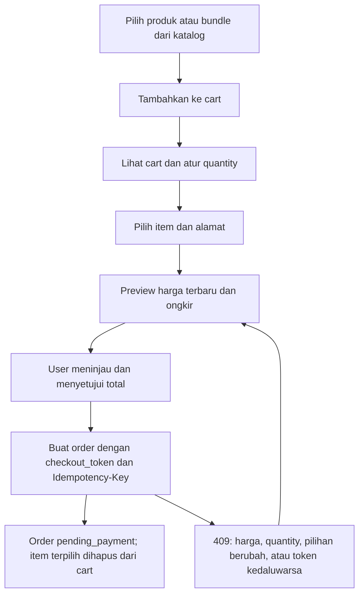

# Alur API Cart dan Checkout

Panduan integrasi frontend untuk menambahkan produk dan bundle ke satu cart, memilih barang yang dibeli, meninjau harga terbaru, lalu membuat order. Mengikuti implementasi backend pada 4 November 2026.

Alur operasional saat ini memakai pembayaran manual dan gratis ongkir: order baru berstatus `pending_payment`, ongkir `0.00`, dan pembayaran dikonfirmasi superadmin setelah diperiksa. Penjelasan konfigurasi server dan pembayaran tersedia di [API order manual](manual-orders.md).

## 1. Persiapan

Base URL contoh: `https://api.example.com/api/v1`. Ganti domain sesuai server. Server lokal dapat menggunakan `http://127.0.0.1:8000/api/v1` jika aplikasi berjalan pada port 8000.

User sudah login melalui [API autentikasi customer](web-authentication-api.md). Endpoint cart, alamat, checkout, dan order memerlukan akun aktif serta token dengan ability `customer-api`.

```http
Authorization: Bearer <TOKEN_CUSTOMER>
Accept: application/json
Content-Type: application/json
```

Katalog dapat diakses tanpa token. Gunakan [API katalog produk](product-catalog.md) untuk memperoleh listing, varian, dan bundle yang tersedia.

Seluruh ID, nama, nomor pesanan, tanggal, dan nominal contoh bersifat ilustratif. Gunakan ID serta token yang benar-benar dikembalikan server. Harga dan total pada cart, preview, serta order berupa string desimal dalam rupiah, misalnya `"15000.00"`.

## 2. Urutan proses



| Langkah | Request | Data yang disimpan frontend |
|---|---|---|
| 1 | `GET /catalog/products` atau `GET /catalog/bundles` | ID listing dan varian yang dipilih |
| 2 | `POST /cart/items` | Respons cart terbaru |
| 3 | `GET /cart` | `data.items[].id` untuk pilihan checkout |
| 4 | `PATCH /cart/items/{item}` jika quantity diubah | Respons cart terbaru |
| 5 | `GET /addresses` atau `POST /addresses` | `address_id` milik user |
| 6 | `POST /checkout/preview` | Item terpilih, harga terbaru, total, dan `checkout_token` |
| 7 | `POST /orders` setelah user setuju | ID order dan nomor pesanan |
| 8 | `GET /orders/{order}` | Status dan petunjuk pembayaran |
| 9 | `GET /cart` | Sisa item yang tidak dibeli |

## 3. Pahami ID yang digunakan

| Nama | Sumber | Digunakan untuk |
|---|---|---|
| `listing_id` | Listing produk di katalog | Tambah produk ke cart |
| `variant_id` | `variants[].id` pada katalog/detail produk | Memilih varian produk |
| `bundle_listing_id` | `listing_id` pada listing bundle di katalog | Tambah bundle ke cart |
| ID item cart | `data.items[].id` pada respons cart | Ubah/hapus item dan isi `cart_item_ids` |
| `address_id` | ID dari API alamat user | Alamat tujuan checkout |
| `checkout_token` | `data.checkout_token` dari preview | Mengonfirmasi isi pilihan serta harga yang ditinjau |
| ID order | `data.id` dari pembuatan order | Membaca detail pesanan |

ID master produk atau bundle bukan ID listing. ID item cart juga berbeda dari ID varian, listing, maupun item order.

## 4. Tambah barang ke cart

### Produk

`POST /cart/items`

```json
{
  "type": "product",
  "listing_id": 101,
  "variant_id": 201,
  "quantity": 2
}
```

`listing_id` dan `variant_id` wajib berupa integer positif. Varian harus aktif dan menjadi bagian dari produk pada listing. Listing, produk, serta toko harus memenuhi aturan kelayakan pembelian.

### Bundle

Endpoint sama: `POST /cart/items`.

```json
{
  "type": "bundle",
  "bundle_listing_id": 301,
  "quantity": 1
}
```

Bundle menggunakan harga tetap master bundle. Frontend tidak perlu mengirim ID varian komponen atau menghitung harga dari jumlah harga komponennya. Komponen bundle ditentukan backend.

### Aturan penambahan

- `quantity` wajib integer 1–99. Kirim `type` secara eksplisit agar jenis barang jelas.
- Untuk produk, kombinasi listing dan varian yang sama digabung pada baris cart yang sudah ada. Varian atau listing toko berbeda menjadi baris terpisah.
- Untuk bundle, listing bundle yang sama digabung pada baris cart yang sudah ada.
- `POST` menambahkan quantity, bukan menggantinya. Jumlah gabungan dibatasi 99; penambahan melampaui 99 tidak otomatis menghasilkan error jika quantity request masih valid.
- Harga diambil backend dari database. Frontend tidak menentukan `unit_price`, subtotal, ongkir, atau total.
- Respons sukses adalah **200**, berisi seluruh cart terbaru, bukan hanya item yang ditambahkan.
- Request tambah yang dikirim ulang dapat menambah quantity lagi. Perlindungan `Idempotency-Key` pada pembuatan order tidak berlaku untuk penambahan cart.

Pesan sukses: `Produk berhasil ditambahkan ke cart.` atau `Bundle berhasil ditambahkan ke cart.`

## 5. Lihat dan kelola cart

### Daftar cart gabungan

`GET /cart`

Produk dan bundle berada dalam satu `data.items`. Item yang terakhir ditambahkan berada di atas. Menambahkan ulang item melalui `POST` memperbarui waktu penambahannya; mengubah quantity melalui `PATCH` tidak mengubah urutan penambahan. Jika waktunya sama, ID item terbesar didahulukan. Item lama tanpa waktu penambahan khusus memakai waktu pertama dibuat.

Contoh respons dengan satu bundle dan satu produk:

```json
{
  "data": {
    "id": 1,
    "items": [
      {
        "id": 15,
        "type": "bundle",
        "listing_id": null,
        "bundle_listing_id": 301,
        "variant_id": null,
        "product": null,
        "bundle": {
          "id": 30,
          "name": "Paket Herbal A",
          "slug": "paket-herbal-a",
          "items": [
            {
              "product": {"id": 10, "name": "Produk Herbal A", "slug": "produk-herbal-a", "product_code": "PRD-010"},
              "variant": {"id": 201, "name": "Botol 60 ml", "sku": "PRD-010-60", "price": "15000.00", "weight_grams": 150},
              "quantity": 2
            }
          ]
        },
        "store": {"id": 1, "name": "Toko Utama", "slug": "toko-utama"},
        "variant": null,
        "quantity": 1,
        "unit_price": "40000.00",
        "subtotal": "40000.00"
      },
      {
        "id": 12,
        "type": "product",
        "listing_id": 101,
        "bundle_listing_id": null,
        "variant_id": 201,
        "product": {"id": 10, "name": "Produk Herbal A", "slug": "produk-herbal-a"},
        "bundle": null,
        "store": {"id": 1, "name": "Toko Utama", "slug": "toko-utama"},
        "variant": {"id": 201, "name": "Botol 60 ml", "sku": "PRD-010-60"},
        "quantity": 2,
        "unit_price": "15000.00",
        "subtotal": "30000.00"
      }
    ],
    "total_items": 3,
    "subtotal": "70000.00"
  },
  "success": true,
  "message": "Cart berhasil diambil."
}
```

`total_items` adalah jumlah quantity pembelian, bukan jumlah baris atau jumlah komponen fisik bundle. Pada contoh, quantity 2 produk + 1 bundle menghasilkan `total_items: 3`.

Cart belum menyediakan filter query per toko. Frontend dapat mengelompokkan `items` berdasarkan `store.id`, dengan produk dan bundle tetap tergabung dalam toko yang sama. Respons cart tidak memuat gambar; gambar dapat diambil dari data katalog.

Cart kosong tetap mengembalikan 200 dengan `items: []`, `total_items: 0`, dan `subtotal: "0.00"`.

### Ganti quantity

`PATCH /cart/items/12`

```json
{"quantity": 3}
```

Quantity menggantikan jumlah sebelumnya dan wajib 1–99. Gunakan `DELETE` untuk menghapus; quantity `0` tidak diterima. Respons 200 berisi seluruh cart terbaru dengan pesan `Jumlah item cart berhasil diperbarui.`

Item yang tidak ditemukan atau milik user lain menghasilkan 404.

### Hapus satu item

`DELETE /cart/items/12`, tanpa body.

```json
{
  "success": true,
  "message": "Item cart dihapus.",
  "code": "CART_ITEM_DELETED",
  "data": null
}
```

Respons 200. Penghapusan dibatasi ke cart user sendiri; ID yang tidak ada di cart tersebut tetap menghasilkan respons sukses tanpa menghapus item user lain.

### Kosongkan cart

`DELETE /cart`, tanpa body.

Respons 200, pesan `Cart dikosongkan.`, kode `CART_CLEARED`, dan `data: null`. Seluruh produk dan bundle dalam cart user dihapus. Untuk checkout sebagian barang, gunakan `cart_item_ids` agar barang lain tetap tersimpan.

## 6. Pilih barang dan alamat checkout

Pilihan checkbox di frontend dikirim sebagai `cart_item_ids`, misalnya `[12, 15]`. Produk dan bundle dapat dipilih bersama, termasuk dari toko berbeda.

| Parameter | Aturan |
|---|---|
| `cart_item_ids` | Opsional; jika ada, wajib array berurutan dengan minimal satu ID integer positif yang unik |
| `address_id` | Integer positif; harus menunjuk alamat milik user yang login |
| `shipping_address` | Alternatif alamat langsung jika tidak memakai `address_id` |

Jika `cart_item_ids` tidak dikirim, backend memproses seluruh cart. Array kosong, `null`, ID duplikat, serta ID hilang atau milik user lain ditolak dengan 422. Jangan menghilangkan parameter saat pilihan checkbox kosong; hentikan checkout sampai user memilih barang.

Pilihan berlaku untuk seluruh quantity pada baris cart. Untuk membeli lebih sedikit dari quantity saat ini, ubah quantity terlebih dahulu melalui `PATCH /cart/items/{item}`.

Untuk memilih alamat tersimpan, gunakan `GET /addresses`. Jika perlu alamat baru, contoh `POST /addresses`:

```json
{
  "label": "Rumah",
  "name": "Pembeli Walatra",
  "phone": "628123456789",
  "address": "Jalan Contoh Nomor 1",
  "province": "Jawa Barat",
  "city": "Bandung",
  "postal_code": "40135",
  "is_default": true
}
```

Simpan `data.id` dari respons sebagai `address_id`. Detail field, edit/hapus alamat, pengaturan alamat utama, dan lokasi tambahan tersedia di [API alamat customer dan lokasi Everpro](customer-addresses.md).

## 7. Preview checkout dan harga terbaru

`POST /checkout/preview`

```json
{
  "address_id": 5,
  "cart_item_ids": [12, 15]
}
```

Contoh respons 200 jika harga belum berubah:

```json
{
  "success": true,
  "message": "Order dapat diajukan. Stok dan pembayaran akan diverifikasi admin.",
  "data": {
    "checkout_token": "<TOKEN_PREVIEW_DARI_SERVER>",
    "price_changed": false,
    "price_changes": [],
    "simulation": false,
    "payment_required": true,
    "payment_provider": "manual",
    "stock_verification": "pending_manual",
    "checkout_available": true,
    "items": [
      {"cart_item_id": 12, "type": "product", "sku": "PRD-010-60", "quantity": 2, "unit_price": "15000.00", "subtotal": "30000.00"},
      {"cart_item_id": 15, "type": "bundle", "sku": null, "quantity": 1, "unit_price": "40000.00", "subtotal": "40000.00"}
    ],
    "subtotal": "70000.00",
    "shipping": {
      "service": "FREE",
      "eta_days": null,
      "gross_fee": "0.00",
      "subsidy": "0.00",
      "fee": "0.00",
      "subsidy_rule_id": null
    },
    "total": "70000.00"
  }
}
```

### Arti field preview

| Field | Makna |
|---|---|
| `items` | Hanya item yang dipilih; kaitkan `cart_item_id` dengan `items[].id` dari cart untuk nama barang, varian, dan toko |
| `price_changed` | Harga terbaru berbeda dari harga yang tersimpan pada cart |
| `price_changes` | Rincian harga tersimpan dan harga terbaru untuk item terpilih |
| `checkout_token` | Konfirmasi pilihan, quantity, dan harga; terikat akun dan berlaku 15 menit |
| `checkout_available` | Checkout dapat diajukan; pada mode manual bukan jaminan stok fisik sudah diperiksa |
| `stock_verification` | `pending_manual` berarti stok masih perlu diperiksa admin |
| `shipping.fee` | Ongkir bersih; `0.00` selama gratis ongkir aktif |
| `total` | Subtotal item terpilih + ongkir |

Jangan mengandalkan urutan array preview sama dengan cart. Gunakan ID untuk mencocokkan item.

Preview membaca harga master terbaru, sehingga subtotalnya dapat berbeda dari subtotal cart. Harga produk memakai harga varian; harga bundle memakai harga tetap bundle. Preview tidak mengubah harga tersimpan, quantity, maupun isi cart dan tidak membuat order. Perubahan harga barang yang tidak dipilih tidak memengaruhi checkout ini.

Preview boleh tanpa alamat dengan body `{"cart_item_ids": [12, 15]}`. Dalam kondisi tersebut, subtotal serta pemeriksaan item tetap tersedia, tetapi `shipping` dan `total` adalah `null`. Sebelum user mengonfirmasi pesanan, panggil preview lagi dengan alamat tujuan. Jika mengirim `shipping_address`, objek tidak boleh kosong dan field wajibnya harus lengkap.

### Jika harga berubah

Sebagai contoh terpisah, hanya produk cart 12 dipilih, quantity 2, dan harga berubah dari Rp15.000 menjadi Rp20.000. Preview tetap mengembalikan 200. Cuplikan `data`:

```json
{
  "checkout_token": "<TOKEN_PREVIEW_TERBARU>",
  "price_changed": true,
  "price_changes": [
    {
      "cart_item_id": 12,
      "type": "product",
      "previous_unit_price": "15000.00",
      "current_unit_price": "20000.00"
    }
  ],
  "subtotal": "40000.00",
  "total": "40000.00"
}
```

Frontend menampilkan harga dan total terbaru untuk ditinjau user. Setelah user setuju, kirim `checkout_token` dari preview tersebut pada create order. Jangan langsung membuat order secara otomatis hanya karena `checkout_available` bernilai `true`.

Token tidak membekukan harga di database atau mereservasi stok. Jika harga, quantity, atau pilihan berubah sesudah preview, backend meminta preview baru saat pembuatan order.

## 8. Konfirmasi dan buat order

`POST /orders`

Tambahkan header selain header autentikasi:

```http
Idempotency-Key: checkout-20261104-001
```

Untuk melanjutkan contoh utama dua item dengan total Rp70.000:

```json
{
  "address_id": 5,
  "cart_item_ids": [12, 15],
  "checkout_token": "<TOKEN_PREVIEW_DARI_SERVER>"
}
```

Kirim pilihan serta alamat yang sudah ditinjau user. `checkout_token` wajib menggunakan nilai asli dari respons preview, bukan teks placeholder di atas. Jika token dikirim, harus string tidak kosong maksimal 4.096 karakter. `Idempotency-Key` wajib tidak kosong dan maksimal 100 karakter.

Jika memakai alamat langsung, contoh body alternatif:

```json
{
  "cart_item_ids": [12, 15],
  "checkout_token": "<TOKEN_PREVIEW_DARI_SERVER>",
  "shipping_address": {
    "name": "Pembeli Walatra",
    "phone": "628123456789",
    "address": "Jalan Contoh Nomor 1",
    "province": "Jawa Barat",
    "city": "Bandung",
    "postal_code": "40135"
  }
}
```

Alamat wajib saat create order: gunakan `address_id` atau objek `shipping_address` yang lengkap. Jika keduanya dikirim, backend memakai alamat tersimpan dari `address_id`.

### Respons order berhasil

Respons pertama **201**. Berikut cuplikan; respons lengkap juga menyertakan alamat serta snapshot `items` produk/bundle:

```json
{
  "data": {
    "id": 90,
    "order_number": "WAL-CONTOH123456",
    "status": "pending_payment",
    "payment_provider": "manual",
    "simulation": false,
    "payment_required": true,
    "payment_instructions": "Hubungi admin untuk petunjuk pembayaran. Pembayaran akan diverifikasi secara manual.",
    "paid_at": null,
    "currency": "IDR",
    "subtotal": "70000.00",
    "shipping_gross_fee": "0.00",
    "shipping_subsidy": "0.00",
    "shipping_fee": "0.00",
    "shipping_service": "FREE",
    "total": "70000.00",
    "created_at": "2026-11-04T08:00:00+07:00"
  },
  "success": true,
  "message": "Order berhasil dibuat."
}
```

Petunjuk pembayaran mengikuti konfigurasi server. Backend memvalidasi ulang barang, token, dan harga, menyimpan snapshot order, lalu menghapus hanya baris cart yang dibeli dalam transaksi. Item yang tidak dipilih tetap berada di cart. Cart tidak dihapus saat preview atau request order gagal.

Order yang sudah dibuat mempertahankan snapshot harga dan jumlah, meskipun data master kemudian berubah. Pembayaran tidak otomatis dianggap lunas; status menjadi `paid` setelah superadmin mengonfirmasi.

### Retry dan request bersamaan

- Buat satu `Idempotency-Key` untuk satu pengajuan order. Simpan key dan payload sampai hasilnya diketahui.
- Jika koneksi timeout atau respons hilang, ulangi request dengan **key dan payload yang sama**. Jangan langsung membuat key baru karena order pertama mungkin sudah tersimpan.
- Jika order sebelumnya sudah berhasil, respons ulang adalah 200 dengan ID order yang sama dan pesan `Order sebelumnya berhasil diambil.` Tidak ada order atau riwayat baru yang dibuat, walaupun token sekarang kedaluwarsa atau item sudah dihapus dari cart.
- Backend mengembalikan order lama untuk key yang sama, bukan menggantinya dengan pilihan baru. Gunakan key baru untuk pembelian berbeda atau pengajuan baru yang telah ditinjau ulang.
- Tambah produk/bundle, ubah quantity, hapus item, kosongkan cart, dan create order diproses bergantian per user. Snapshot order konsisten dengan item yang dihapus. Item yang baru ditambahkan sesudah checkout selesai tetap berada di cart; `PATCH` ke ID item yang sudah dibeli menghasilkan 404.

Untuk kompatibilitas, `checkout_token` masih opsional. Request tanpa token diterima jika harga cart belum berubah; jika harga berbeda, backend mengembalikan `409 PRICE_CHANGED`. Integrasi frontend baru sebaiknya selalu melalui preview dan mengirim token setelah user menyetujui total.

## 9. Tangani respons gagal

Tidak semua endpoint memakai envelope error yang sama. Gunakan HTTP status sebagai dasar penanganan dan periksa `code` jika tersedia. Khusus preview, respons cart kosong dan barang nonaktif dapat hanya berisi `success` serta `message`.

| HTTP / kode | Penyebab | Tindakan frontend |
|---|---|---|
| 401 | Token login hilang atau tidak valid | Minta user login kembali |
| 403 | Akun tidak aktif atau ability token tidak sesuai | Tampilkan pesan akses yang dikembalikan server |
| 404 | Item cart, alamat, atau order tidak ditemukan/tidak dimiliki user | Muat ulang data terkait |
| 422 `VALIDATION_ERROR` | Quantity, pilihan item, alamat, atau format token tidak valid | Tampilkan `errors` pada field terkait |
| 422 pada cart kosong | Tidak ada item untuk checkout | Arahkan ke cart/katalog |
| 409 `STALE_CART` pada order | Item terpilih tidak aktif/tidak tersedia | Muat ulang cart dan perbarui pilihan |
| 409 `PRICE_CHANGED` | Order tanpa token memakai harga cart yang sudah berbeda | Panggil preview, tampilkan harga terbaru, konfirmasikan token |
| 409 `CHECKOUT_CHANGED` | Isi pilihan, quantity, atau harga berbeda dari preview bertoken | Buat preview baru dan minta persetujuan user |
| 409 `CHECKOUT_EXPIRED` | Token preview sudah melewati 15 menit | Buat preview baru |
| 503 pada integrasi eksternal | Layanan stok atau layanan terkait tidak tersedia | Tampilkan pesan layanan; jangan menyatakan order berhasil |

ID item hilang atau milik user lain dalam `cart_item_ids` menghasilkan 422. Mengakses ID item tersebut melalui endpoint `PATCH` menghasilkan 404. Item yang tidak dipilih tidak ikut divalidasi kelayakannya untuk checkout sebagian.

Contoh konflik saat harga berubah setelah preview:

```json
{
  "success": false,
  "message": "Pilihan barang, jumlah, atau harga berubah. Silakan tinjau ulang preview checkout.",
  "code": "CHECKOUT_CHANGED",
  "errors": null,
  "data": {
    "price_changes": [
      {
        "cart_item_id": 12,
        "type": "product",
        "previous_unit_price": "15000.00",
        "current_unit_price": "20000.00"
      }
    ]
  }
}
```

`price_changes` membandingkan harga master dengan harga tersimpan pada cart, bukan dengan harga preview sebelumnya. Array ini dapat kosong pada `CHECKOUT_CHANGED` jika perubahannya hanya quantity atau pilihan item. Respons konflik tidak otomatis memperbarui harga cart.

Token rusak atau milik akun lain menghasilkan 422 pada `checkout_token`; jangan mencoba memperbaiki atau membuat token di frontend. Ambil token baru dari preview akun yang sedang login.

## 10. Sesudah order dibuat

1. Simpan `data.id` dan `data.order_number`, lalu tampilkan detail pesanan melalui `GET /orders/{order}`.
2. Tampilkan `status`, `total`, dan `payment_instructions` dari respons server. Endpoint `POST /orders/{order}/payment` juga menyediakan petunjuk pembayaran manual.
3. Muat ulang `GET /cart` agar tampilan sesuai sisa barang yang belum dibeli.
4. Baca status order kembali setelah admin mengonfirmasi pembayaran. `paid` berarti pembayaran sudah dikonfirmasi; bukan otomatis status pengiriman.

Daftar pesanan tersedia melalui `GET /orders`. User dapat membatalkan order yang masih `pending_payment` melalui `POST /orders/{order}/cancel`; order yang sudah dibayar tidak dapat dibatalkan melalui endpoint customer tersebut. Pembatalan tidak otomatis mengembalikan item ke cart. Lihat [API order manual](manual-orders.md) untuk rincian pembayaran dan operasional admin.

## 11. Ringkasan implementasi frontend

- Gunakan satu daftar campuran produk dan bundle, lalu bedakan tampilannya melalui `type`.
- Simpan pilihan berdasarkan ID item cart, bukan indeks array atau ID master produk.
- Setelah quantity, pilihan, atau alamat tujuan diubah, panggil preview lagi sebelum user mengonfirmasi.
- Gunakan `data.items`, subtotal, ongkir, dan total dari preview untuk halaman konfirmasi; harga cart dapat belum mengikuti harga master terbaru.
- Simpan token dari preview terbaru dan kirim hanya setelah user menyetujui harga yang ditampilkan.
- Untuk request order yang sedang berjalan, cegah pengiriman berulang dari tombol frontend dan pertahankan `Idempotency-Key` untuk retry.
- Tanggapi konflik dengan preview baru. Jangan menghapus isi cart atau menandai pembayaran lunas dari frontend.
- Pada mode manual, ketersediaan stok fisik tetap diperiksa admin. Gratis ongkir tidak mengubah kewajiban verifikasi pembayaran.
