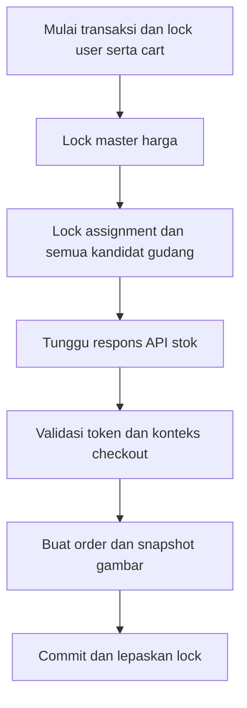

# Audit lanjutan lock checkout dan gudang

Tanggal: 23 November 2026. Repository Backend Walatra, basis commit `08d9117c43dbf421a564d0da68ea76764e7dabea`, dengan perbaikan akses ekspor customer yang sudah ada di working tree. Audit ini memperdalam QC02 dari [laporan awal](../2026-11-23-qc-security/README.md).

**Kesimpulan: antrean checkout antar pengguna berhasil dibuktikan melalui request checkout yang berjalan pada proses terpisah.** Dampaknya melampaui gudang yang akhirnya dipilih: kandidat yang beririsan dapat menyebabkan antrean, varian yang sama dapat mengantre lebih awal pada pemeriksaan harga, dan sinkronisasi gudang dapat membentuk deadlock dengan checkout. Jalur tersebut juga menjalankan pemeriksaan stok sebelum memvalidasi keaslian token checkout.

Kode aplikasi tidak diubah pada audit lanjutan ini. Pengujian dan bukti berada di folder audit. Perbaikan ekspor customer sebelumnya tetap dipertahankan.

## Cara pembuktian

Pengujian memakai PostgreSQL 14.24, database sementara dengan prefix `walatra_checkout_lock_audit_`, dua proses aplikasi, dan koneksi pengamat. Setiap skenario dimulai dengan migrasi pada database sementara tersebut, dua customer sintetis, cart yang berbeda, dan preview yang sesuai. Skenario token invalid mengganti token milik request pertama dengan string tidak valid sebelum checkout.

Proses A ditahan pada stub respons API stok. Proses B kemudian mengirim request melalui HTTP kernel Laravel. Pengamat memeriksa `pg_stat_activity`, query yang menunggu, dan `pg_blocking_pids` untuk memastikan A benar-benar memblokir B. Setelah lock teramati, koordinator menunggu sekitar 350 ms sebelum melepas respons A. Skenario kontrol memastikan B bisa selesai selagi A masih ditahan.

Lock, transaksi, query, dan respons aplikasi berjalan nyata di PostgreSQL. Respons penyedia stok serta direktori gudang dipalsukan. Pada pengujian deadlock, event model menahan sinkronisasi sesudah update W2 agar urutan eksekusi yang bermasalah dapat direproduksi. Angka durasi adalah pengukuran skenario terkontrol, bukan latency upstream nyata, P95, atau kapasitas production.

Skenario menggunakan `check_only`, `nearest_available`, gratis ongkir, dan order manual, tanpa gambar media. Koneksi pengujian melaporkan isolation `read committed`, `lock_timeout=0`, dan `statement_timeout=0`; ini tidak menyatakan konfigurasi server production sama. Metadata serta keberhasilan penghapusan database tersedia di [run.json](evidence/run.json).

## Hasil sembilan skenario

Verifikasi akhir menghasilkan **9 tes, 220 assertion, tanpa failure, error, atau skipped**, dalam sekitar 38,1 detik. Bukti lengkap: [tests.txt](evidence/tests.txt) dan [JUnit](evidence/tests.xml). Durasi di tabel merupakan hasil satu run terkontrol; waktu query mencakup eksekusi serta penantian lock, bukan pengukuran throughput production.

| Skenario | Hasil yang diamati pada B | Bukti |
|---|---|---|
| Produk berbeda, gudang sama | Query gudang 385,87 ms; B belum memanggil stok selama lock ditahan; akhirnya 201 | [shared_warehouse.json](evidence/shared_warehouse.json) |
| Kandidat A W1/W2 dan B W2/W3 | Query gudang 377,91 ms meskipun pilihan akhir W1 dan W3; akhirnya 201 | [unused_overlap.json](evidence/unused_overlap.json) |
| Varian sama | Query master varian 406,85 ms; akhirnya kedua order 201 | [same_variant.json](evidence/same_variant.json) |
| Kandidat terpisah | B selesai 201 sebelum respons stok A dilepas; query gudang 0,40 ms | [disjoint.json](evidence/disjoint.json) |
| Preview bersamaan checkout | Preview B selesai 200 sebelum respons stok A dilepas | [preview.json](evidence/preview.json) |
| Lock timeout 200 ms | B mendapat 500 dengan SQLSTATE 55P03; callback stok B tidak berjalan | [lock_timeout.json](evidence/lock_timeout.json) |
| Koneksi stok A gagal | A 503 dan rollback; B keluar dari antrean lalu 201 | [upstream_failure.json](evidence/upstream_failure.json) |
| Token checkout A invalid | A tetap menahan lock; query gudang B 368,31 ms; A baru ditolak 422 setelah respons stok | [invalid_token.json](evidence/invalid_token.json) |
| Sinkronisasi gudang berurutan terbalik | Deadlock 40P01; checkout 500, sinkronisasi selesai | [sync_deadlock.json](evidence/sync_deadlock.json) |

## Urutan lock dan pekerjaan dalam transaksi

Urutan pada pembuatan order adalah sebagai berikut:

1. Mulai transaksi dan kunci baris user untuk menyelaraskan mutasi cart pengguna tersebut.
2. Kunci alamat tersimpan bila address_id digunakan, kemudian item cart.
3. Kunci master varian produk dan bundle untuk memeriksa harga.
4. Kunci assignment gudang varian.
5. Kunci seluruh baris gudang aktif dan listed yang cocok dengan kandidat bersama.
6. Urutkan kandidat berdasarkan jarak dan periksa stok melalui HTTP secara berurutan.
7. Hitung konteks checkout dan validasi token, buat order serta itemnya, salin gambar bila tersedia, lalu hapus item cart yang dipesan.
8. Commit transaksi luar; lock dilepas.

Sumber: [OrderController.php](../../../app/Http/Controllers/Api/V1/OrderController.php), baris 124–129, 174, 208–221, dan 301–319; [CheckoutPricing.php](../../../app/Services/Marketplace/CheckoutPricing.php), baris 18–22; [CheckoutShippingOrigin.php](../../../app/Services/Marketplace/CheckoutShippingOrigin.php), baris 34–36; [NearestWarehouseSelector.php](../../../app/Services/Warehouse/NearestWarehouseSelector.php), baris 23–24 dan 50–57.



Yang dikunci adalah baris kandidat hasil query, bukan seluruh tabel warehouses. Namun dua cart berbeda dapat memiliki kandidat yang beririsan. Gudang yang akhirnya tidak dipilih tetap terkunci. Penyaringan koordinat valid juga dilakukan setelah query FOR UPDATE selesai.

## Temuan utama

### Antrean meluas ke gudang yang tidak dipilih

**Prioritas P1 untuk ketersediaan dan skala.** Dua pengguna dengan produk berbeda dan gudang yang sama saling menunggu pada SELECT warehouses FOR UPDATE. Tidak diperlukan kesamaan user, cart, atau varian untuk menimbulkan antrean ini.

Kasus yang lebih jelas: kandidat A adalah W1 dan W2, sedangkan kandidat B adalah W2 dan W3. A memilih W1 dan B memilih W3, tetapi B tetap menunggu A karena keduanya mengunci W2. Bukti SQL yang menunggu serta hasil pilihan terdapat di [unused_overlap.json](evidence/unused_overlap.json). Kasus kandidat yang terpisah, W1 melawan W3, dapat berjalan tanpa menunggu pelepasan stok A: [disjoint.json](evidence/disjoint.json).

Ini menjelaskan risiko penurunan kapasitas: koneksi dan proses request B tetap terpakai selama menunggu transaksi A, sementara pekerjaan stok B belum dimulai. Besarnya dampak pada traffic production belum diukur.

### Mengubah lock gudang saja belum menghilangkan seluruh antrean

**Temuan desain yang perlu masuk cakupan perbaikan.** Untuk produk dengan varian yang sama, query pertama yang terblokir pada B adalah SELECT product_variants FOR UPDATE pada CheckoutPricing, sebelum selector gudang dijalankan. Bukti: [same_variant.json](evidence/same_variant.json).

Lock ini memiliki tujuan konsistensi: harga yang digunakan order tidak boleh berubah selama pembuatan snapshot. Perbaikan perlu menjaga tujuan tersebut sambil mengurangi pemakaian exclusive lock dan lamanya transaksi. Menghapus seluruh lock tanpa pengganti dapat membuka race pada harga, cart, assignment, atau status master.

### Timeout pemilihan stok tidak mencakup waktu menunggu lock

**Prioritas P2 untuk pengendalian latency.** Deadline dibuat pada baris 50 NearestWarehouseSelector, setelah query penguncian gudang selesai. Waktu menunggu user, cart, master harga, assignment, dan gudang tidak dikurangi dari budget ini. Batas tersebut juga bukan deadline seluruh pembuatan order setelah stok selesai diperiksa.

Pada pengujian B diberi budget pemilihan gudang 100 ms, tetapi B tetap sukses setelah menunggu lock gudang lebih dari 300 ms. Selama antrean, callback HTTP B belum dipanggil. Bukti: [shared_warehouse.json](evidence/shared_warehouse.json).

Ketika lock_timeout PostgreSQL disetel khusus 200 ms pada koneksi B, transaksi dibatalkan dengan SQLSTATE `55P03`. Aplikasi mengembalikan HTTP 500, belum respons terkontrol yang dapat dicoba ulang. B tidak membuat order dan cart tetap utuh. Bukti: [lock_timeout.json](evidence/lock_timeout.json). Semantik lock_timeout dijelaskan pada [dokumentasi PostgreSQL 14](https://www.postgresql.org/docs/14/runtime-config-client.html#GUC-LOCK-TIMEOUT).

### Checkout dapat deadlock dengan sinkronisasi master gudang

**Prioritas P1 untuk kegagalan operasional.** Selector checkout mengambil gudang menurut code ascending. WarehouseSyncService memperbarui baris dalam urutan daftar dari provider, yang tidak disortir menjadi urutan lock yang sama.

Interleaving yang berhasil direproduksi:

1. Sinkronisasi memakai daftar W2, W1 dan meng-update W2 di dalam transaksi.
2. Checkout dengan kandidat W1, W2 mengambil W1 lalu menunggu W2.
3. Sinkronisasi melanjutkan update W1, sehingga menunggu checkout.
4. PostgreSQL mendeteksi siklus dan membatalkan salah satu transaksi dengan SQLSTATE `40P01`.

Pada hasil yang direkam, checkout menjadi korban dan mengembalikan HTTP 500; sinkronisasi berhasil. Order tidak terbentuk dan cart customer tetap berisi item. Korban deadlock dapat berubah sesuai penjadwalan; tes menerima kedua kemungkinan, bukan menganggap checkout selalu menjadi korban. Bukti: [sync_deadlock.json](evidence/sync_deadlock.json).

Sumber: [WarehouseSyncService.php](../../../app/Services/Warehouse/WarehouseSyncService.php), baris 59–63, dibandingkan urutan penguncian selector. Pencegahan melalui urutan lock konsisten dan sifat pemilihan korban didukung oleh [dokumentasi deadlock PostgreSQL 14](https://www.postgresql.org/docs/14/explicit-locking.html#LOCKING-DEADLOCKS). Pengujian membuktikan kemungkinan kejadian, bukan frekuensi deadlock pada server production.

### Token checkout invalid tetap menjalankan jalur lock dan HTTP

**Prioritas P2, dapat memperbesar dampak terhadap ketersediaan.** Form request hanya memvalidasi bentuk string token. Dekripsi, kepemilikan, masa berlaku, dan fingerprint dipastikan belakangan oleh CheckoutPricing::confirm, sesudah pemeriksaan stok.

Request A memakai string `invalid-audit-token`, berhasil mengambil lock dan masuk ke stub stok. Selama A ditahan, checkout customer B yang valid menunggu lock gudang. Setelah A dilepas, A baru mendapat 422 VALIDATION_ERROR; B kemudian berhasil. Bukti: [invalid_token.json](evidence/invalid_token.json).

Prasyaratnya adalah pengguna customer aktif yang terautentikasi, mempunyai cart dan data alamat yang lolos validasi; ini bukan akses anonim. Route POST orders belum memiliki throttle khusus pada [routes/api.php](../../../routes/api.php). Rate limit di reverse proxy production belum diperiksa. Bukti ini tidak melibatkan pembanjiran request.

Sumber: [CreateOrderRequest.php](../../../app/Http/Requests/Api/V1/CreateOrderRequest.php), baris 19; [OrderController.php](../../../app/Http/Controllers/Api/V1/OrderController.php), baris 209 dan 221; [CheckoutPricing.php](../../../app/Services/Marketplace/CheckoutPricing.php), metode confirm.

## Batas jaminan stok pada check_only

**Lock saat ini tidak sama dengan reservasi stok.** Dalam skenario varian yang sama, upstream sintetis menjawab stok satu pada setiap panggilan. Kedua checkout berjalan bergiliran dan sama-sama menghasilkan order quantity satu, sehingga total quantity order adalah dua. Kedua order tidak memiliki stock_reservation_id dan stock_check.reserved bernilai false. Bukti: [same_variant.json](evidence/same_variant.json).

Hal ini sesuai jalur check_only di [OrderController.php](../../../app/Http/Controllers/Api/V1/OrderController.php), baris 248, yang sengaja melewati reserve. Karena upstream uji tidak mengurangi stok, pengujian tersebut menunjukkan bahwa serialisasi lokal saja tidak memberikan jaminan alokasi stok. Ini bukan bukti stok production benar-benar oversold; hasil aktual bergantung pada kapan sistem gudang memperbarui stok serta kebijakan verifikasi order manual.

Jika kebutuhan bisnis adalah stok tidak boleh terjual melebihi jumlah tersedia, perlu reservasi atomik yang menjadi sumber kebenaran, termasuk aturan kedaluwarsa dan pelepasan. Jika check_only memang berarti verifikasi manual belakangan, kontrak itu perlu dipertahankan dan tidak dipresentasikan sebagai reservasi otomatis.

## Perilaku yang bekerja sesuai harapan

Kandidat yang terpisah dapat menyelesaikan checkout B ketika A masih ditahan. Preview B juga selesai ketika checkout A menahan lock karena preview tidak meminta lock eksklusif yang sama. Kedua hasil ini membatasi temuan: bukan seluruh request aplikasi berhenti ketika satu checkout menunggu stok.

Kegagalan koneksi stok sintetis pada A menghasilkan HTTP 503, transaksi rollback, cart A tetap utuh, dan B yang sebelumnya menunggu dapat melanjutkan hingga HTTP 201. Pada semua hasil, kedalaman transaksi sesudah request kembali nol. Artinya pelepasan lock saat error bekerja dalam skenario ini; masalah utamanya adalah cakupan dan durasi lock, deadlock, serta pemetaan error database.

Bukti kontrol: [preview.json](evidence/preview.json), [disjoint.json](evidence/disjoint.json), dan [upstream_failure.json](evidence/upstream_failure.json).

## Rekomendasi perbaikan

Urutan berikut mempertimbangkan penyebab yang dibuktikan, bukan hanya gejala timeout:

1. Validasi murah keaslian token, user, dan expiry sebelum mengambil lock bersama atau memanggil upstream. Tetap lakukan konfirmasi fingerprint akhir atas snapshot yang konsisten; pemeriksaan awal tidak menggantikan validasi akhir.
2. Samakan urutan penguncian semua jalur yang memperbarui master gudang. Untuk WarehouseSyncService, urutkan publikasi baris berdasarkan code sambil mempertahankan sifat publikasi snapshot atomik. Periksa pula jalur deaktivasi/unlisting dan penghapusan saat merancang urutan menyeluruh.
3. Pisahkan pembacaan snapshot serta panggilan API stok dari transaksi commit yang singkat. Pada commit, validasi ulang versi atau fingerprint data yang menentukan harga, cart, assignment, dan asal pengiriman. Perubahan relevan harus meminta preview baru, bukan diam-diam memakai data usang.
4. Evaluasi shared lock untuk master yang hanya dibaca, atau pemeriksaan versi optimistis. Jika memakai shared lock, samakan strategi seluruh pembaca dan penulis; shared lock masih dapat menahan update admin, sehingga pemindahan HTTP keluar transaksi tetap penting.
5. Tetapkan deadline request yang mencakup antrean dan pekerjaan berikutnya. Gunakan lock_timeout/statement_timeout yang sesuai pada transaksi atau koneksi checkout, lalu petakan SQLSTATE 55P03 dan 40P01 menjadi respons sementara yang jelas, misalnya 409 atau 503 dengan petunjuk retry. Hindari mengubah timeout semua proses database tanpa evaluasi.
6. Tambahkan pembatas laju request checkout/preview per customer dan jalur observabilitas untuk lock wait. Pertahankan Idempotency-Key ketika klien mencoba ulang. Retry deadlock harus terbatas dan hanya untuk operasi yang aman diulang; jangan mengulang seluruh transaksi yang memiliki efek filesystem atau panggilan eksternal secara buta.
7. Putuskan jaminan bisnis check_only secara eksplisit. Penambahan reservasi upstream adalah perubahan kontrak bisnis, bukan sekadar optimasi query.

Mengganti query dengan SKIP LOCKED dapat mengubah pilihan gudang hanya karena gudang terdekat sedang dipakai request lain. Menghapus lock gudang saja juga tidak menyelesaikan antrean varian. Keduanya perlu dinilai terhadap semantik pemilihan gudang, konsistensi harga, dan token preview sebelum dipakai sebagai perbaikan.

## Pengulangan dan batas audit

Jalankan dari root repository:

```bash
php docs/audits/2026-11-23-checkout-locks/run-postgres.php
```

Runner membutuhkan akses PostgreSQL lokal dan izin membuat/menghapus database. Database sementara dibuat otomatis lalu dihapus pada finally. Worker memeriksa prefix database sebelum menjalankan pengujian. Request terhadap API stok/direktori nyata, pembayaran live, dan database aplikasi aktif tidak digunakan. File koordinasi sementara dibersihkan setelah setiap skenario.

Skenario terdefinisi pada [CheckoutLockAuditTest.php](CheckoutLockAuditTest.php), request checkout pada [checkout-worker.php](checkout-worker.php), dan proses sinkronisasi pada [warehouse-sync-worker.php](warehouse-sync-worker.php). Probe sengaja memverifikasi perilaku masalah, termasuk HTTP 500; hasil tes lulus bukan berarti perilaku production yang diuji sudah aman.

Codebase Memory dipakai untuk pencarian simbol, trace, snippet, dan coverage path bukti; urutan penting diverifikasi melalui source serta runtime karena edge graph PHP dapat ambigu. Tidak ada pengujian beban besar, P95/P99, server HTTP/reverse proxy production, upstream nyata, bundle dengan banyak komponen, atau media lambat. Perilaku bundle dan snapshot gambar yang disebutkan berasal dari source, sedangkan pengukuran konkurensi menggunakan produk tunggal tanpa gambar.
